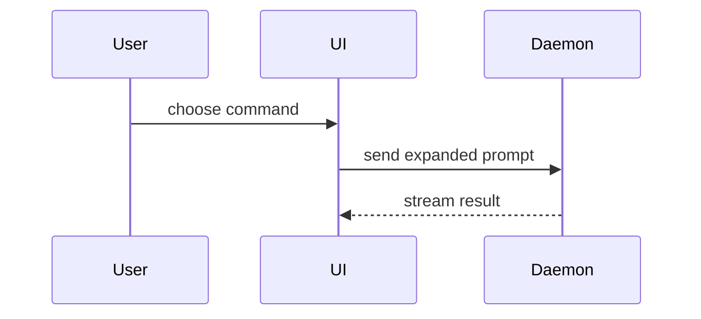

# PR

Write a title and body for a pull request from the current branch. Don't push, and don't open the pull request. The user does both.

## Inputs

1. Use the base and target the user names. Otherwise use the repo's default branch as the base and `HEAD` as the target.
2. Read `git log <base>..<target>` and `git diff <base>...<target>`.
3. If the user names a feature, load `issue-tracker`. Fetch the spec, the current acceptance ticket, and its manual tickets. If the acceptance ticket isn't `done`, say so at the top of your reply.

## Output

Reply with a title, then the body in a fenced `markdown` block so the user can copy it. If the body contains code blocks, use four backticks for the outer fence. Keep the title under 70 characters and start it with a verb. Replace secrets, such as API keys, tokens, passwords, and private keys, with `[REDACTED]`, including in evidence and command output.

Use this template for the body:

```markdown
## Summary

<one to three sentences on what this PR changes and why>

<optional: diagram, diff-sketch, or tree>

## Evidence

- **Before:** <screenshot/output/failing test run>
  **After:** <screenshot/output/passing test run>

## Merge Danger

**Door:** <one-way or two-way>

<optional: description>

**Blast Radius:** <one or two sentences on what the change affects>
```

## Sections

Skip all preambles and keep prose brief. Use the user's domain language from `GLOSSARY.md`.

### Summary

Start with one to three sentences on what the PR changes and why it exists. The title already names the change, so lead with why. With a feature, take the why from the spec's Problem statement.

Add a visual only when the sentences don't make the change clear. Then pick the smallest view that makes the key point clear. Add another view only when it shows something the first one doesn't.

The views below are examples, not a checklist. Use one only when the change needs it, or pick another form that fits better.

- Show logic or an algorithm as pseudocode:

```text
on(save)
  if content is unchanged
    return cached result
  write new content
  return fresh result
```

- Show runtime control flow as a call tree:

```text
submitForm
  createSession
    persistPrompt
    launchAgent
  navigateToSession
```

- Show UI structure as a component tree, including state and module boundaries that matter:

```text
<SessionPage> (apps/example/src/routes/session.tsx)
  useSessionEvents()
  <SessionToolbar>
    <RunSkillButton> (packages/ui)
```

- Show file responsibility or a broad refactor as a shallow file tree:

```text
src/
├── commands/       # parses user actions
├── sessions/       # owns session state
└── transport/      # sends API requests
```

- Show component interaction, control flow, or data flow with Mermaid:



- Use `diff` when the point is what changes and the surrounding shape already exists. Match the diff shape to the topic.

For a component change:

```diff
 <SessionPage>
   useSessionEvents()
   <SessionToolbar>
+    <RunSkillButton />
   <SessionTimeline>
+    <SkillResultCard />
```

For a file-layout change:

```diff
 src/
 ├── commands/
+│   └── show-me.ts       # expands the slash command
 ├── sessions/
-└── transport.ts
+└── transport/
+    ├── client.ts
+    └── stream.ts
```

For a call-tree or call-stack change:

```diff
 submitForm
   createSession
     persistPrompt
+    expandSkillMention
     launchAgent
-  navigateToSession
+  navigateToSession
+    subscribeToEvents
```

For a state or control-flow change:

```diff
 on(save)
-  write content
+  if content is unchanged
+    return cached result
+  write new content
+  invalidate cache
```

- Show the whole block when most of it is new, when omitted context would hide ownership or order, or when the user needs a copyable target shape:

```ts
function expandSkill(command: string): string {
  const skillName = command.slice(1);
  return `use the ${skillName} skill`;
}
```

#### Guidance

Place each visual next to the short text it supports. Keep only the calls, files, props, states, and boundaries a reviewer needs to understand the change.

### Evidence

Concrete evidence that the change works. Show a before and after.

Screenshots are S-tier when the environment supports them and the change is visual.

Execution-based evidence is A-tier. Test results, console output. Show the exact test that now fails and passes, using pseudocode.

With a feature, use the verification results in the acceptance ticket's comments and the evidence on its manual tickets.

### Merge Danger

Describe whether it's a one-way or two-way door. You can walk back through two-way doors, but not one-way doors. A PR that is cheap to roll back is lower risk. Changes that involve destructive actions or hard-to-reverse decisions are one-way doors.

The blast radius is what the change can affect if it's wrong. Name it in one or two sentences. Consider every part of the system it touches, such as layout shift, breakage for consumers, or mobile responsiveness.
